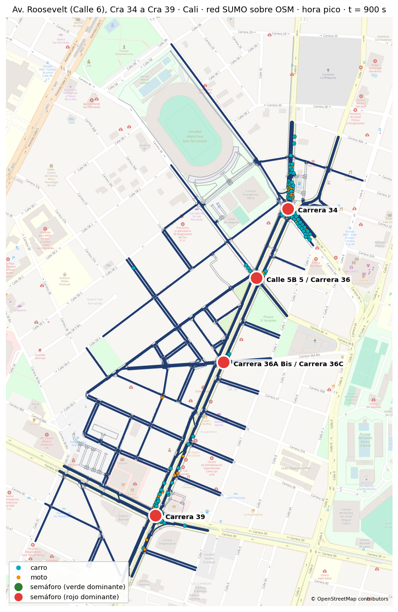
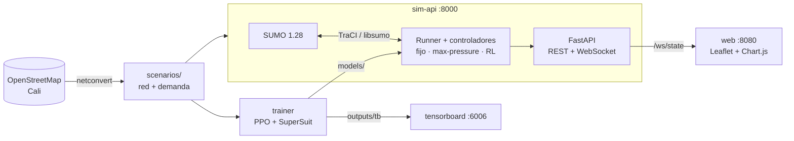

# 🚦 Gemelo digital de movilidad urbana · Cali

**Semáforos que aprenden.** Un gemelo digital de la **Av. Roosevelt** de Cali construido en [SUMO](https://eclipse.dev/sumo/) a partir de OpenStreetMap, donde cada intersección semaforizada es un **agente de aprendizaje por refuerzo** que decide sus fases y se coordina con sus vecinas. Lo comparamos contra el tiempo fijo y un controlador adaptativo, con carros, motos y peatones, en un panel web con mapa en vivo.

> Proyecto académico · Milton Quintero (simulación y RL) · Jose Arias (panel web y evaluación)
> Demo: **jueves 29 oct 2026** · Entrega final: **17 nov 2026**

<p align="center">
  
  <br>
  <sub>Red SUMO real (OSM → netconvert) de la Av. Roosevelt (Calle 6) entre la Cra 34 y la Cra 39, georreferenciada sobre el mapa de OpenStreetMap. Las 4 intersecciones semaforizadas son los agentes; puntos azules = carros, naranja = motos. Imagen generada por el contenedor con la demanda de hora pico del dataset (semilla 0).</sub>
</p>

---

## ¿Qué se busca?

| # | Objetivo | Cómo se mide |
|---|---|---|
| 1 | Red **real de Cali** con 4–9 intersecciones semaforizadas, carros, motos y peatones | Red de OSM georreferenciada (4 tls en la demo, corredor completo después) |
| 2 | Tres escenarios de demanda: **valle**, **pico** y **evento** (cierre de carril por accidente) | Dataset de demanda reproducible por semilla |
| 3 | Tres estrategias sobre el mismo tráfico: **tiempo fijo**, **adaptativo** (max-pressure / actuated) y **RL multiagente** | Mismas rutas y semillas para todas |
| 4 | Los agentes RL logran **≥ 15 % menos tiempo de espera** que el tiempo fijo en hora pico | 5 semillas de evaluación nunca vistas en el entrenamiento |
| 5 | Métricas: tiempo de viaje, espera, colas y **equidad entre vías** (índice de Jain) | `outputs/eval/` |
| 6 | Panel web: mapa en vivo, semáforos, eventos, selector de estrategia y gráficas | `http://localhost:8080` |

> **Regla del proyecto:** ningún número de este repo se inventa. Todo resultado sale de una ejecución real y se cita el archivo de `outputs/` que lo produjo. Si el objetivo del 15 % no se cumple, se reporta con los números reales.

## La inteligencia artificial

Aprendizaje por refuerzo multiagente (**MARL**): un agente por semáforo, todos con **la misma red neuronal** (parámetros compartidos), entrenados con **PPO**.

| Elemento | Definición |
|---|---|
| Agente | Un semáforo (tls) de SUMO |
| Observación | Fase actual (one-hot), verde mínimo cumplido, tiempo en fase, densidad y cola por carril de entrada **+ cola media de cada intersección vecina** |
| Acción | Siguiente fase verde (discreta); amarillo de 3 s automático; verde mínimo 10 s |
| Recompensa | `r_i = −Δespera_i − presión_i` y `r̂_i = r_i + α · media(r_vecinas)` (α = 0 independientes, α = 0,3 coordinados) |
| Algoritmo | PPO con parámetros compartidos (Stable-Baselines3 + SuperSuit sobre el entorno PettingZoo de sumo-rl) |
| Decisión | Cada 5 s simulados · episodios de 1 h · libsumo, sin GUI |

**¿Y el dataset?** En RL el agente aprende de la experiencia que genera en el simulador, pero esa experiencia depende de la demanda. Por eso generamos un **dataset de escenarios** (`python -m sim.demand --dataset`):

- **Entrenamiento:** 20 archivos de hora pico (semillas 100–119); cada episodio toma uno al azar.
- **Evaluación:** semillas 0–4 de valle, pico y evento, **nunca vistas** durante el entrenamiento.
- 35 % de motos (vClass `motorcycle`); los viajes entran y salen por los bordes de la red, con mayor peso en la Roosevelt y sus transversales semaforizadas.
- `scenarios/roosevelt4/demand/manifest.csv` registra cada archivo con sus conteos.

## Arquitectura



Todo corre en **Docker** (imagen oficial `ghcr.io/eclipse-sumo/sumo:1.28.0` + Python 3.11). No hay que instalar SUMO ni Python en el equipo.

## Inicio rápido

```bash
git clone https://github.com/josearpa123/Gemelo_digital_cali.git
cd Gemelo_digital_cali
make build          # imágenes sim-api, trainer (una vez)
make dataset        # genera el dataset de demanda (≈ 6 s)
make up             # sim-api + web
open http://localhost:8080
```

| Comando | Qué hace |
|---|---|
| `make test` | tests rápidos dentro del contenedor |
| `make train ALPHA=0 SEED=0` | entrenamiento PPO en segundo plano (`docker logs -f train_a0_s0`) |
| `make tensorboard` | curvas de entrenamiento en `http://localhost:6006` |
| `make demo` | levanta el sistema y corre la checklist de la demo |
| `docker compose run --rm sim-api python -m sim.network.build_osm --zone roosevelt4` | regenera la red desde OSM |

Desde otro equipo de la misma red: `http://<IP-del-equipo>:8080`.

## Estado

| Hito | Fecha | Estado |
|---|---|---|
| H0 · Workspace, Docker y hooks | 27 oct | ✅ |
| H1 · Demo (red real, pico con motos, 3 estrategias, mapa en vivo) | 29 oct | 🔄 red ✅ · dataset ✅ · entrenamiento PPO ✅ en marcha · panel web en curso |
| H2 · Corredor completo (6–9 tls), peatones, 3 escenarios | 2 nov | ⏳ |
| H3 · MARL independiente vs coordinado (α = 0 vs 0,3) | 9 nov | ⏳ |
| H4 · Evaluación 5 semillas, tablas, figuras, informe | 16 nov | ⏳ |

Detalle en [`PLAN.md`](PLAN.md), avance día a día en [`BITACORA.md`](BITACORA.md) y tareas en los [issues](https://github.com/josearpa123/Gemelo_digital_cali/issues).

## Estructura

```
sim/        red (OSM→netconvert), demanda/dataset, controladores, runner TraCI
rl/         entorno multiagente, observación con vecinas, recompensa con α, entrenamiento
api/        FastAPI: /health, /api/network, /api/control, /ws/state
web/        panel (Leaflet + Chart.js) servido por nginx
eval/       métricas (incluido Jain), evaluación 3×3×5, figuras
scenarios/  redes y demanda de Cali
models/     modelos entrenados (generados)
outputs/    métricas, TensorBoard, figuras (generados)
tests/      pytest: unitarios, integración, humo, e2e
docker/     Dockerfile y nginx
```

## Cómo trabajamos

- Ramas `feat/h<n>-<tema>`, commits pequeños en inglés, documentación en español.
- Usamos [Claude Code](https://claude.com/claude-code) con hooks del repo (`.claude/`): bloquean comandos destructivos y acceso a secretos, formatean con ruff, corren los tests al terminar cada turno y **mantienen la bitácora**: al abrir una sesión muestran qué se hizo, los commits nuevos y los issues abiertos; al cerrar, piden registrar *Hecho / Siguiente / Bloqueos* en `BITACORA.md`.

---

<sub>Datos del mapa © colaboradores de OpenStreetMap (ODbL).</sub>
