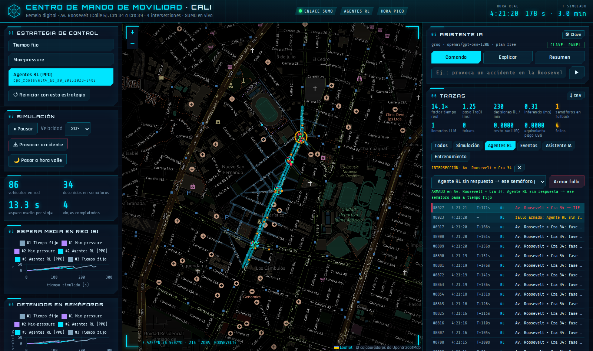
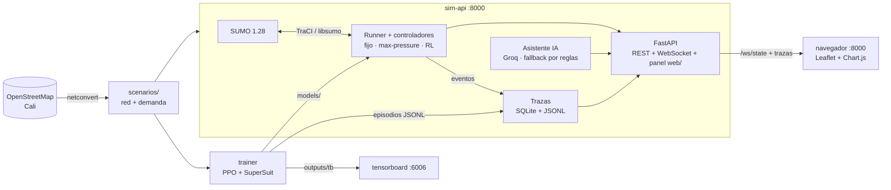

# 🚦 Gemelo digital de movilidad urbana · Cali

**Semáforos que aprenden.** Un gemelo digital de la **Av. Roosevelt** de Cali construido en [SUMO](https://eclipse.dev/sumo/) a partir de OpenStreetMap, donde cada intersección semaforizada es un **agente de aprendizaje por refuerzo** que decide sus fases y se coordina con sus vecinas. Lo comparamos contra el tiempo fijo y un controlador adaptativo, con carros, motos y peatones, en un panel web con mapa en vivo.

> Proyecto académico · Milton Quintero (simulación y RL) · Jose Arias (panel web y evaluación)
> Demo: **jueves 29 oct 2026** · Entrega final: **17 nov 2026**

<p align="center">
  
  <br>
  <sub>Red SUMO real (OSM → netconvert) de la Av. Roosevelt (Calle 6) entre la Cra 34 y la Cra 39, georreferenciada sobre el mapa de OpenStreetMap. Las 4 intersecciones semaforizadas son los agentes; puntos azules = carros, naranja = motos. Imagen generada por el contenedor con la demanda de hora pico del dataset (semilla 0).</sub>
</p>

---

## ¿Qué se busca?

| # | Objetivo | Cómo se mide |
|---|---|---|
| 1 | Red **real de Cali** con 4–9 intersecciones semaforizadas, carros, motos y peatones | Red de OSM georreferenciada (4 tls en la demo, corredor completo después) |
| 2 | Tres escenarios de demanda: **valle**, **pico** y **evento** (cierre de carril por accidente) | Dataset de demanda reproducible por semilla |
| 3 | Tres estrategias sobre el mismo tráfico: **tiempo fijo**, **adaptativo** (max-pressure / actuated) y **RL multiagente** | Mismas rutas y semillas para todas |
| 4 | Los agentes RL logran **≥ 15 % menos tiempo de espera** que el tiempo fijo en hora pico | 5 semillas de evaluación nunca vistas en el entrenamiento |
| 5 | Métricas: tiempo de viaje, espera, colas y **equidad entre vías** (índice de Jain) | `outputs/eval/` |
| 6 | Panel web: mapa en vivo, semáforos, eventos, selector de estrategia, gráficas, **trazas** y **asistente de IA** | `http://localhost:8000` |

> **Regla del proyecto:** ningún número de este repo se inventa. Todo resultado sale de una ejecución real y se cita el archivo de `outputs/` que lo produjo. Si el objetivo del 15 % no se cumple, se reporta con los números reales.

## La inteligencia artificial

Aprendizaje por refuerzo multiagente (**MARL**): un agente por semáforo, todos con **la misma red neuronal** (parámetros compartidos), entrenados con **PPO**.

| Elemento | Definición |
|---|---|
| Agente | Un semáforo (tls) de SUMO |
| Observación | Fase actual (one-hot), verde mínimo cumplido, tiempo en fase, densidad y cola por carril de entrada **+ cola media de cada intersección vecina** |
| Acción | Siguiente fase verde (discreta); amarillo de 3 s automático; verde mínimo 10 s |
| Recompensa | `r_i = −Δespera_i − presión_i` y `r̂_i = r_i + α · media(r_vecinas)` (α = 0 independientes, α = 0,3 coordinados) |
| Algoritmo | PPO con parámetros compartidos (Stable-Baselines3 + SuperSuit sobre el entorno PettingZoo de sumo-rl) |
| Decisión | Cada 5 s simulados · episodios de 1 h · libsumo, sin GUI |

**¿Y el dataset?** En RL el agente aprende de la experiencia que genera en el simulador, pero esa experiencia depende de la demanda. Por eso generamos un **dataset de escenarios** (`python -m sim.demand --dataset`):

- **Entrenamiento:** 20 archivos de hora pico (semillas 100–119); cada episodio toma uno al azar.
- **Evaluación:** semillas 0–4 de valle, pico y evento, **nunca vistas** durante el entrenamiento.
- 35 % de motos (vClass `motorcycle`); los viajes entran y salen por los bordes de la red, con mayor peso en la Roosevelt y sus transversales semaforizadas.
- `scenarios/roosevelt4/demand/manifest.csv` registra cada archivo con sus conteos.

## Panel en vivo

<p align="center">
  
  <br>
  <sub>Captura tomada por la prueba end-to-end (Playwright) contra el sistema real: agentes RL en hora pico, con el fallo «Agente RL sin respuesta» armado. La intersección afectada pasa a tiempo fijo y la traza lo muestra en vivo.</sub>
</p>

Todo está en **`http://localhost:8000`**: mapa, controles, gráficas, trazas y asistente. FastAPI sirve también los archivos de `web/`. nginx en `:8080` quedó como opción (`docker compose --profile nginx up -d web`).

Controles: estrategia (tiempo fijo · max-pressure · agentes RL), reiniciar con el mismo tráfico para comparar, pausa, velocidad (1×–50×), provocar/despejar accidente y cambiar entre hora pico y valle. Las gráficas guardan una serie por corrida para comparar estrategias lado a lado.

### Trazas

Cada parte del sistema deja eventos con `trace_id`, hora real, tiempo simulado, componente, tipo, estado y sus datos. Se guardan en `outputs/traces.db` (SQLite) y en `outputs/traces/events.jsonl`, y llegan en vivo al panel por el WebSocket.

| Componente | Qué registra |
|---|---|
| Simulación | inicio y fin de escenario (zona, escenario, estrategia, semilla); por **segundo simulado**: vehículos por tipo, latencia del paso en ms y factor de tiempo real; errores de TraCI y reconexión |
| Agentes RL | cada decisión: intersección, fase anterior → elegida, motivo (cola y espera por aproximación), recompensa, α y uso de vecinas, inferencia en ms, versión del modelo; cambios de estrategia, carga de modelos y **fallback a tiempo fijo** si un agente falla o tarda > 200 ms |
| Eventos | accidente (calle, carril, duración), cambio de demanda, pausa y reanudación, con su **impacto** medido: espera y cola al inyectarlo y 2 min simulados después |
| Asistente IA | proveedor, modelo, tokens, latencia, costo real y equivalente pago, reintentos, errores, acción validada/ejecutada/rechazada y fallback |
| Entrenamiento | por episodio: recompensa media, espera media, duración y timesteps (lo escribe el contenedor `trainer` y el panel lo lee) |

En el panel hay indicadores: factor de tiempo real, latencia de paso, decisiones RL por minuto, inferencia, semáforos en fallback, llamadas LLM, tokens, costo real y equivalente pago, y fallos. También hay filtros por componente, clic en una intersección del mapa para ver solo sus decisiones, detalle de cada evento y exportación a CSV. **Armar fallo** aplica una sola vez y luego se desarma:

| Fallo | Respaldo |
|---|---|
| Agente RL sin respuesta | ese semáforo pasa a tiempo fijo 120 s y luego vuelve el agente |
| Detector con datos perdidos | el agente usa el último valor válido de la observación |
| Desconexión de TraCI | se guarda el estado, SUMO se reinicia y el escenario sigue en el mismo segundo* |
| Timeout del LLM / Límite 429 | 2 reintentos con espera exponencial y luego respuesta por reglas |
| Respuesta inválida del LLM | la acción se rechaza; no se ejecuta nada |

<sub>* El panel usa libsumo (SUMO dentro del mismo proceso), así que no hay un socket que se pueda cortar: el fallo se simula cerrando y reabriendo SUMO con `saveState`/`loadState`. Un error real de libsumo usa el mismo camino desde el último punto de control (cada 300 s simulados).</sub>

API: `GET /api/traces` (filtros `component`, `tls_id`, `type`, `desde`, `hasta`, `limit`), `GET /api/traces/{trace_id}`, `GET /api/traces/summary`, `GET /api/traces/export.csv`, `POST /api/faults/arm`.

**Costo del trazado.** Se mide con `make bench-tracing`: mismo escenario y semilla, con y sin trazas, en pares intercalados a máxima velocidad. El resultado queda en `outputs/bench/tracing.json` y el estado de la medición está en `PLAN.md` (H-TRAZAS).

### Asistente de IA

El LLM **no controla semáforos**; eso lo hacen los agentes RL. Tiene tres usos:

- **Explicar**, por ejemplo «¿por qué la Cra 39 cambió a verde?». Responde con las trazas reales de esa decisión: colas, espera, fase y recompensa.
- **Comandos**, por ejemplo «provoca un accidente en la Roosevelt», «pasa a hora pico» o «compara RL contra tiempo fijo». El LLM devuelve un JSON con una acción de una lista blanca, que se valida con Pydantic antes de ejecutarse.
- **Resumen** de la corrida, a partir de sus métricas.

Si el LLM falla o no hay clave, responde por reglas con los mismos datos y la simulación sigue igual.

Proveedor por defecto: **Groq**, modelo `openai/gpt-oss-120b`, en el plan gratis. El costo real es US$ 0 y el panel muestra también el equivalente pago a precio de lista: 0,15 US$ por millón de tokens de entrada y 0,60 de salida, verificado el 30 oct 2026 y guardado en `config/llm_pricing.yaml`. Se puede cambiar de proveedor con `LLM_PROVIDER`, `LLM_MODEL` y `LLM_BASE_URL` (por ejemplo, Ollama local con `openai_compat`).

**La clave se puede poner desde el propio panel** (⚙ Clave en «Asistente IA»). Se guarda solo en el servidor, en `secrets/`, que está fuera de git y tiene permisos 600, y nunca se vuelve a mostrar. También se puede poner como `GROQ_API_KEY` en el archivo de entorno. Nunca aparece en trazas, logs ni respuestas de la API.

## Arquitectura



Todo corre en **Docker** (imagen oficial `ghcr.io/eclipse-sumo/sumo:1.28.0` + Python 3.11). No hay que instalar SUMO ni Python en el equipo.

## Cómo correrlo desde cero

Solo se necesitan **Git** y **Docker** (Docker Desktop en Windows y macOS, Docker Engine en Linux). No hay que instalar SUMO ni Python.

**Linux / macOS / WSL**

```bash
git clone https://github.com/josearpa123/Gemelo_digital_cali.git
cd Gemelo_digital_cali
cp .env.example .env      # opcional: escribe tu GROQ_API_KEY (o ponla luego desde el panel)
docker compose up -d --build sim-api
# abre http://localhost:8000
```

**Windows (PowerShell, con Docker Desktop abierto)**

```powershell
git clone https://github.com/josearpa123/Gemelo_digital_cali.git
cd Gemelo_digital_cali
Copy-Item .env.example .env   # opcional: escribe tu GROQ_API_KEY (o ponla luego desde el panel)
docker compose up -d --build sim-api
# abre http://localhost:8000
```

La primera vez, construir la imagen tarda varios minutos, y `sim-api` genera las demandas de tráfico (con semillas fijas) si faltan. Los modelos RL entrenados no se versionan: en un clon nuevo la estrategia RL aparece como «sin modelo» hasta entrenar uno (`make train`). Sin clave de Groq todo funciona y el asistente responde por reglas. La clave se consigue gratis en `console.groq.com/keys` y se puede pegar en el panel (⚙ Clave). Si el puerto 8000 está ocupado por otro programa, hay que cerrarlo antes.

Para medir el tiempo hasta ver la app (lo que pide la prueba del compañero):

```bash
bash scripts/medir_arranque.sh                                         # Linux / macOS / WSL
powershell -ExecutionPolicy Bypass -File scripts\medir_arranque.ps1    # Windows
```

| Comando | Qué hace |
|---|---|
| `make up` | levanta `sim-api` (panel, API y trazas en `:8000`) |
| `make test` | tests rápidos dentro del contenedor (sin llamadas reales al LLM) |
| `make test-live` | **una** llamada real a Groq con tu clave: modelo, tokens, costo y límites de la cuenta |
| `make bench-tracing` | costo del trazado sobre la simulación → `outputs/bench/tracing.json` |
| `make dataset` | regenera el dataset de demanda (≈ 6 s) |
| `make train ALPHA=0 SEED=0` | entrenamiento PPO en segundo plano (`docker logs -f train_a0_s0`) |
| `make tensorboard` | curvas de entrenamiento en `http://localhost:6006` |
| `make evaluate MODELS="models/ppo_…" SCENARIOS="valley peak event"` | fijo · max-pressure · RL sobre las semillas de evaluación 0–4 → `outputs/eval/` (`summary.md`, `goal_check.md`) |
| `make train-smoke` | PPO 1000 timesteps y carga del modelo (test lento) |
| `make demo` | levanta el sistema y corre la checklist de la demo |
| `make e2e` | prueba del panel en un navegador real (Playwright en Docker), capturas en `outputs/e2e/` |
| `docker compose run --rm sim-api python -m sim.network.build_osm --zone roosevelt4` | regenera la red desde OSM |

Desde otro equipo de la misma red: `http://<IP-del-equipo>:8000`.

## Estado

| Hito | Fecha | Estado |
|---|---|---|
| H0 · Workspace, Docker y hooks | 27 oct | ✅ |
| H1 · Demo (red real, pico con motos, 3 estrategias, mapa en vivo) | 29 oct | 🔄 red ✅ · dataset ✅ · panel web ✅ · max-pressure ✅ · evaluación ✅ · PPO entrenando |
| H-TRAZAS · Trazas, asistente de IA, panel en :8000 | 31 oct – 3 nov | 🔄 implementado; pendiente revisión (ver `PLAN.md`) |
| H2 · Corredor completo (6–9 tls), peatones, 3 escenarios | 2 nov | ⏳ |
| H3 · MARL independiente vs coordinado (α = 0 vs 0,3) | 9 nov | ⏳ |
| H4 · Evaluación 5 semillas, tablas, figuras, informe | 16 nov | ⏳ |

Detalle en [`PLAN.md`](PLAN.md), avance día a día en [`BITACORA.md`](BITACORA.md) y tareas en los [issues](https://github.com/josearpa123/Gemelo_digital_cali/issues).

## Estructura

```
sim/        red (OSM→netconvert), demanda/dataset, controladores, runner TraCI
rl/         entorno multiagente, observación con vecinas, recompensa con α, entrenamiento
api/        FastAPI: /health, /api/network, /api/control, /ws/state
web/        panel (Leaflet + Chart.js) servido por nginx
eval/       métricas (incluido Jain), evaluación 3×3×5, figuras
scenarios/  redes y demanda de Cali
models/     modelos entrenados (generados)
outputs/    métricas, TensorBoard, figuras (generados)
tests/      pytest: unitarios, integración, humo, e2e
docker/     Dockerfile y nginx
```

## Cómo trabajamos

- Ramas `feat/h<n>-<tema>`, commits pequeños en inglés, documentación en español.
- Usamos [Claude Code](https://claude.com/claude-code) con hooks del repo (`.claude/`): bloquean comandos destructivos y acceso a secretos, formatean con ruff, corren los tests al terminar cada turno y **mantienen la bitácora**: al abrir una sesión muestran qué se hizo, los commits nuevos y los issues abiertos; al cerrar, piden registrar *Hecho / Siguiente / Bloqueos* en `BITACORA.md`.

---

<sub>Datos del mapa © colaboradores de OpenStreetMap (ODbL). Fuentes Orbitron, Rajdhani y Share Tech Mono (SIL Open Font License, Google Fonts).</sub>

### Prueba del compañero

| Dato | Valor |
|---|---|
| Quién la hizo | **Alexandra Merchán** |
| Fecha | **2026-10-29** |
| Sistema operativo | **Windows** |
| Tiempo hasta ver la app en `localhost:8000` | **[ minutos]** |
| Problemas encontrados y cómo se corrigieron | **[ o "ninguno"]** |
